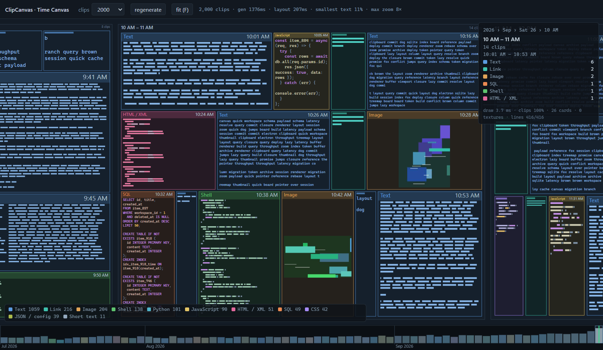

# ClipCanvas

**Your whole clipboard history, on one zoomable timeline.**

ClipCanvas keeps everything you copy on Windows — text, code, links and images —
and lays it out on one canvas shaped like a wall calendar. Every day has its own
cell, and it never moves: zoom into a day and it holds its hours, and each hour
holds the clips you copied in it, in the order you copied them. You don't open
folders; you zoom in.


- **Everything stays where it is.** A day's place comes from its date alone,
  like a drawing in AutoCAD. Copying something new changes today and nothing
  else; June is always where June was.

- **In the order you copied.** An image copied between two text clips sits
  between them. Nothing is filed away by type.
- **The whole clip.** Every card holds its complete text, never a two-line
  preview. Long clips are small until you zoom in, and then every line is
  readable.
- **When, on every card.** Each clip shows the time you copied it.
- **Colour says what it is.** Prose, short snippets, links and images each have
  a colour, and so does code in each language: JavaScript, Python, SQL, HTML,
  CSS, JSON / config and shell.
- **Local.** One SQLite file and a folder of images on your own machine. Nothing
  is uploaded.



| A month | A day |
| --- | --- |
|  |  |


<sub>Screenshots are from the demo page (`npm run demo`), which generates
synthetic clips.</sub>

## Quick start

```bash
npm install     # also rebuilds better-sqlite3 for Electron (postinstall)
npm start
```

Or install it like any Windows app: `npm run build` writes
`dist/ClipCanvas Setup <version>.exe`. What changed in each version is in
[CHANGELOG.md](CHANGELOG.md).

ClipCanvas starts in the system tray. Press `Ctrl+Shift+V`, or click the tray
icon, to open or hide the window. Closing the window hides it; quit from the
tray menu. It starts with Windows from then on (untick *Start with Windows* in
the tray menu to stop that).

To build the Windows installer:

```bash
npm run build   # dist/ClipCanvas Setup <version>.exe
```

## Using it

| | |
| --- | --- |
| scroll / pinch | zoom toward the cursor |
| drag | pan, with inertia |
| click | select a clip and open its details |
| double-click | fly into the box under the cursor |
| right-click / Backspace | fly back out one level |
| F / Home | fit everything |
| T | today |
| + / − · arrows | zoom · pan |
| / | search — results appear as you type; ↑ ↓ and Enter, or click, fly to a clip |
| Esc | close search or details, then hide the window |

- **Opens on today.** The current day is outlined in green. Scroll out for the
  month, the year, and every year you have.
- **Top bar** — choose the workspace and board, and show Active, Starred,
  Pinned, Archived, Trash or All clips. *Capturing* shows whether copies are
  being saved; click it to pause. *Today* and *Fit* move the camera. New clips
  are saved to the active workspace; Personal, Research and College are
  created on first run.
- **Details** — the full text or image, an editable title, and Copy back,
  Star, Pin, Archive and Delete. Delete moves a clip to Trash; in Trash,
  Restore brings it back and *Empty trash* deletes everything there for good,
  after telling you how many clips and how much space.
- **Timeline strip** — the days on screen are lit; click a day to fly to it.
- **Info panel** — where you are, what is under the cursor, and how many clips
  of each kind are in view.

## How it works

- **Capture.** The main process asks Windows every 700 ms whether the
  clipboard has changed (`GetClipboardSequenceNumber`, through
  [koffi](https://koffi.dev)) — about a microsecond — and reads the clipboard
  only when it has. Images are checked first and saved as PNG under
  `storage/images/YYYY/MM/`; text is classified as a link, code or prose and
  stored in SQLite. Whatever is already on the clipboard when the app starts is
  not captured, and neither is anything a password manager marks as private.
  Capture can be paused from the tray or the top bar.
- **Storage.** [better-sqlite3](https://github.com/WiseLibs/better-sqlite3),
  with additive migrations and an FTS5 search index kept in step by triggers.
  Images reach the window through a `clip-asset://` protocol that resolves
  nothing outside the storage folder.
- **Canvas.** A canvas-2D engine in [`src/renderer/canvas`](src/renderer/canvas/README.md):
  a fixed calendar for years, months and days; inside each day an
  order-preserving strip treemap of hours and clips, with per-card font fitting
  so that every card holds its whole text; and four levels of detail, from
  solid tiles to syntax-coloured glyphs.
- **Loading like a map.** Zoomed out, the canvas needs only how many clips of
  each kind every day has — one small query. A day's clips are fetched when its
  cell is big enough on screen to show them, and dropped again when it is far
  away, so the history can grow without the window slowing down. A new copy
  re-reads the counts and reloads today only.
- **Isolation.** The window runs with context isolation and a strict
  Content-Security-Policy. The preload script exposes an allow-list of IPC
  channels, never `ipcRenderer` itself.

The canvas's look is inspired by code-city visualisers that fly through a
source tree, where every file is a box and every box is readable up close.

## Scripts

| | |
| --- | --- |
| `npm start` | run the app |
| `npm run dev` | run it with DevTools, and show the window at launch |
| `npm run build` | build the Windows installer into `dist/` |
| `npm test` | classification, calendar, layout, clipboard watcher and image-protocol checks, on plain Node |
| `npm run lint` | ESLint (correctness rules only) |
| `npm run test:db` | database migration and per-day queries (under Electron) |
| `npm run verify:app` | check the real app end to end, against a copy of your database |
| `npm run bundle` | rebuild the canvas bundles after editing `src/renderer/canvas/` |
| `npm run demo` | serve the demo at <http://localhost:8790> |
| `npm run screenshots` | retake the screenshots in `docs/` from the demo |

The renderer runs under context isolation, so it loads one prebuilt bundle
instead of modules. GitHub Actions runs both checks on every push and fails if a
committed bundle does not match its sources.

## Project structure

```text
src/
  main/
    main.js            window, tray, hotkey, start with Windows, IPC
    clipwatch.js       clipboard watcher: change detection, private copies skipped
    settings.js        small settings file (pause, start with Windows)
    db.js              SQLite data layer
    preload.js         allow-listed bridge to the renderer
    assetProtocol.js   clip-asset:// -- serves stored images
    classifyText.js    the type a captured clip is stored as
  renderer/
    index.html         UI shell
    style.css
    renderer.js        top bar, info panel, details, search
    canvas/            the Time Canvas engine -- see its README
    timecanvas.bundle.js   built from canvas/
  assets/              app and tray icon
demo/                  the canvas on its own, with synthetic clips
test/               checks, benchmarks and diagnostics -- see its README
planning/              product decisions, roadmap and audits
docs/                  screenshots
```

`SESSION-NOTES.md` is the working summary of the project — its aim, how it is
built, where it stands and what comes next. The planning record of v1, whose
source was lost, is in `planning/archive/v1/`.

## Data

Everything is stored in Electron's user-data folder:

```text
C:\Users\<you>\AppData\Roaming\clipcanvas\clipcanvas.db     the database
C:\Users\<you>\AppData\Roaming\clipcanvas\storage\images\   captured images
C:\Users\<you>\AppData\Roaming\clipcanvas\logs\              clipcanvas.log: errors and events
```

The tray menu opens the storage folder and the log.

- `created_at` is Unix **seconds**. Each clip also stores `year`, `month`,
  `day`, `weekday` and `hour`, which the time queries group by.
- Tables: `workspaces`, `boards`, `clips`, and `clips_fts`, an external-content
  FTS5 index maintained by triggers.
- Migrations are additive — `CREATE TABLE IF NOT EXISTS` and guarded
  `ALTER TABLE … ADD COLUMN` — so an existing install upgrades in place.

## Troubleshooting

### `better_sqlite3.node` was compiled against a different Node.js version

`better-sqlite3` is a native module, and it must match Electron's Node ABI, not
your system Node's:

```text
The module better_sqlite3.node was compiled against a different Node.js version.
NODE_MODULE_VERSION 137. This version of Node.js requires NODE_MODULE_VERSION 121.
```

Rebuild it for Electron:

```bash
npx electron-builder install-app-deps
npm start
```

### `Cannot read properties of undefined (reading 'getPath')`

Electron is running as plain Node because `ELECTRON_RUN_AS_NODE=1` is set in
the shell. Clear it and start again:

```powershell
Remove-Item Env:ELECTRON_RUN_AS_NODE -ErrorAction SilentlyContinue
npm start
```

### `better-sqlite3` build error during install

First try:

```bash
npm install
npx electron-builder install-app-deps
```

If it still builds from source and fails, install Visual Studio Build Tools with
the Desktop development with C++ workload and a Windows SDK, then retry.

### Build fails: `Cannot create symbolic link ... libcrypto.dylib`

`npm run build` downloads electron-builder's `winCodeSign` bundle and extracts
it with 7-Zip. That archive contains **macOS** symlinks, and creating a symlink
on Windows needs either administrator rights or Developer Mode — so extraction
fails, and the build dies during `packaging`, before NSIS ever runs:

```text
ERROR: Cannot create symbolic link : A required privilege is not held by the
client. : ...\winCodeSign\<id>\darwin.12\lib\libcrypto.dylib
```

Nothing in a Windows build needs those `darwin/` files. The fix is to extract
the archive yourself without them, into the exact directory electron-builder
looks for — `winCodeSign-2.6.0`, **not** `winCodeSign`. It will then skip the
download entirely:

```bash
CACHE="$LOCALAPPDATA/electron-builder/Cache/winCodeSign"
./node_modules/7zip-bin/win/x64/7za.exe x -y "$CACHE"/*.7z   -o"$CACHE/winCodeSign-2.6.0" '-xr!darwin'
rm -rf "$CACHE"/[0-9]*          # failed attempts leave numbered temp dirs
```

The permanent alternative is to turn on **Settings → System → For developers →
Developer Mode**, which grants symlink privilege to non-admin users; then the
normal download path works.

### Nothing new is being captured

Check the pill in the top bar. *Capture paused*: click it to resume. *Capture
error*: the clipboard cannot be read — tray menu → *Open log file* says why. If ClipCanvas was not running at all, it may not be
registered to start with Windows: open it once with `npm start` and make sure
*Start with Windows* is ticked in the tray menu. (An old
`Start_ClipCanvas_Hidden.vbs` in the Windows Startup folder that points at a
folder that has since moved does nothing and can be deleted.)

### The window does not appear

ClipCanvas starts as a tray utility. Press `Ctrl+Shift+V`, or open it from the
ClipCanvas icon in the Windows system tray.

### Hotkey conflict

Change the `globalShortcut.register` call in `src/main/main.js`.

## Roadmap

From [`planning/`](planning/):

- Grouped view for busy hours: folders by kind inside an hour
- Cleanup by hour, day, month and year, with starred and pinned clips protected
- A small always-available capsule near the taskbar, with copy feedback
- Search by date and kind: `today`, `last week`, `images june 2026`
- File and PDF clips
