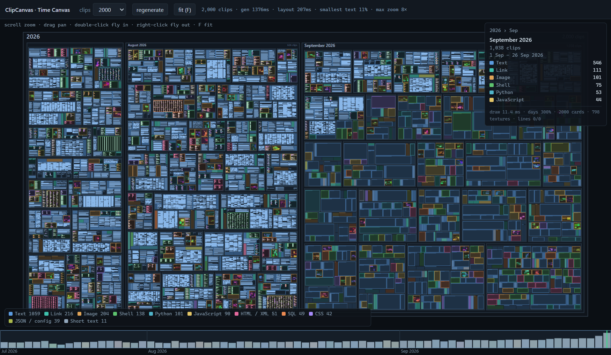

# ClipCanvas

**Your whole clipboard history, on one zoomable timeline.**

ClipCanvas keeps everything you copy on Windows — text, code, links and images —
and lays it out as one canvas. Years hold months, months hold days, days hold
hours, and each hour holds the clips you copied in it, in the order you copied
them. You don't open folders; you zoom in.



- **In the order you copied.** An image copied between two text clips sits
  between them. Nothing is filed away by type.
- **The whole clip.** Every card holds its complete text, never a two-line
  preview. Long clips are small until you zoom in, and then every line is
  readable.
- **When, on every card.** Each clip shows the time you copied it.
- **Colour says what it is.** Prose, short snippets, links and images each have
  a colour, and so does code in each language: JavaScript, Python, SQL, HTML,
  CSS, JSON / config and shell.
- **Local.** One SQLite file and a folder of images on your own machine. Nothing
  is uploaded.


| A day | One clip, up close |
| --- | --- |
|  |  |

<sub>Screenshots are from the demo page (`npm run demo`), which generates
synthetic clips.</sub>

## Quick Start

```bash
# 1. Install dependencies
npm install

# 2. Rebuild native dependencies for Electron
npx electron-builder install-app-deps

# 3. Run the app
npm start
```

The panel opens from the system tray and may start hidden. Toggle it with `Ctrl+Shift+V` or the ClipCanvas tray icon.

## Important Windows Note

If Electron starts like plain Node and crashes with `app.getPath` being undefined, clear `ELECTRON_RUN_AS_NODE` before launching:

```powershell
Remove-Item Env:ELECTRON_RUN_AS_NODE -ErrorAction SilentlyContinue
npm start
```

For a one-off direct launch:

```powershell
Remove-Item Env:ELECTRON_RUN_AS_NODE -ErrorAction SilentlyContinue
.\node_modules\.bin\electron.cmd .
```

## Native SQLite Dependency

ClipCanvas uses `better-sqlite3`, which is a native module. Native modules must match Electron's Node ABI, not only the system Node version.

After `npm install`, run:

```bash
npx electron-builder install-app-deps
```

This installs or rebuilds `better-sqlite3` for the installed Electron runtime. This fixes errors like:

```text
The module better_sqlite3.node was compiled against a different Node.js version.
NODE_MODULE_VERSION 137. This version of Node.js requires NODE_MODULE_VERSION 121.
```

Current dependency notes:

- `better-sqlite3`: `^12.10.0`
- `electron`: `^29.0.0`
- `electron-builder`: `^24.9.1`

## Scripts

```bash
npm start       # Run Electron app
npm run dev     # Run Electron app with --dev
npm run build   # Build Windows installer with electron-builder
```

## Project Structure

```text
clipcanvas/
  src/
    main/
      main.js       Electron main process: window, tray, clipboard watcher
      db.js         SQLite database layer using better-sqlite3
      preload.js    Secure bridge between main and renderer
    renderer/
      index.html    Panel UI shell
      style.css     Dark UI styles
      renderer.js   UI logic for views, search, cards, and actions
  package.json
  README.md
```

The SQLite database is created in Electron's user data directory, for example:

```text
C:\Users\<you>\AppData\Roaming\clipcanvas\clipcanvas.db
```

## What's In v2

| Feature | Status |
| --- | --- |
| Clipboard hook for text, code, URL, and image clips | Done |
| Local SQLite storage | Done |
| System tray and `Ctrl+Shift+V` hotkey | Done |
| Canvas view grouped by clip type | Done |
| Timeline view, newest first | Done |
| Recall/search view | Done |
| Copy-back to clipboard | Done |
| Delete clips | Done |
| Select mode | Done |
| Auto-tagging by type and URL domain | Done |
| Workspaces: Personal, Research, College, and custom spaces | Done |
| Boards inside each workspace | Done |
| Starred, Pinned, Archived, and Trash filters | Done |
| Clip details panel for title, tags, workspace, board, and state | Done |
| Smart canvas grouping and masonry layout | Done |
| Lightweight minimap and zoom controls | Done |
| Storage dashboard | Done |

## Workspace Canvas Milestone

ClipCanvas now works as both a clipboard manager and a visual knowledge workspace.

### Workspaces

Default workspaces:

- Personal
- Research
- College

Users can create custom workspaces. New clipboard captures are saved into the active workspace.

### Boards

Boards live inside workspaces. Example seeded boards:

- Research: MongoDB, React, APIs
- College: Final Year Project, Internship, Viva

Supported board actions:

- Create board
- Rename board
- Delete board
- Move clips between boards
- Filter the Canvas, Timeline, and Recall views by board

### Clip States

Supported clip states:

- Starred
- Pinned
- Archived
- Trash

Pinned clips are shown first and remain visible on the Canvas while working in a selected board. Archive actions do not archive starred clips. Delete moves clips to Trash; Empty Trash permanently removes records and attempts to delete physical file clips.

### Canvas

The Canvas now groups clips by type:

- Images
- URLs
- Text
- Code
- Files

The layout uses masonry-style columns with consistent spacing and no card overlap. Cards can be dragged onto board names in the sidebar to move them between boards.

### Minimap

The Canvas includes a lightweight minimap in the bottom-right corner. It reflects the current card layout, shows a viewport rectangle, supports click-to-navigate, and updates with scroll and zoom.

### Clip Details

Selecting a clip opens the details panel. Editable fields:

- Title
- Tags
- Workspace
- Board
- Pinned
- Starred
- Archived

Displayed metadata:

- Type
- Date
- Source

### Storage Dashboard

The Settings view displays:

- Total storage used
- Breakdown by images, files, PDFs, and text
- Largest clips
- Oldest clips

Actions:

- Archive old clips
- Empty Trash
- Open storage folder

## Schema And Migrations

The app uses additive SQLite migrations in `src/main/db.js`. Existing installs are migrated at startup with `CREATE TABLE IF NOT EXISTS`, `ALTER TABLE ... ADD COLUMN`, and default data seeding.

Current tables:

```text
workspaces
  id
  name
  slug
  is_default
  created_at
  updated_at

boards
  id
  workspace_id
  name
  created_at
  updated_at

clips
  id
  type
  content
  title
  source
  tags
  group_id
  workspace_id
  board_id
  is_starred
  is_archived
  is_pinned
  deleted_at
  canvas_x
  canvas_y
  created_at
  updated_at
```

Indexes are maintained for workspace/board filtering, active canvas queries, starred/pinned/trash views, search, and storage dashboard scans.

## Performance Notes

The UI keeps the app responsive by:

- Loading bounded clip slices from SQLite
- Rendering Canvas groups from the current workspace/filter slice
- Limiting Timeline rendering to the newest visible entries
- Keeping the minimap DOM lightweight
- Avoiding expensive canvas redraw loops

The current target is smooth interaction with 10,000+ stored clips while showing a practical working slice in the UI.

## Testing Checklist

- Start the app after `npm install` and `npx electron-builder install-app-deps`.
- Verify default workspaces appear: Personal, Research, College.
- Create a custom workspace and confirm new clips can be captured there.
- Verify Research boards appear: MongoDB, React, APIs.
- Verify College boards appear: Final Year Project, Internship, Viva.
- Create, rename, and delete a board.
- Drag a clip onto a board in the sidebar and confirm it moves.
- Filter Canvas by board and confirm pinned clips remain visible.
- Pin and unpin a clip.
- Star a clip, then run archive actions and confirm starred clips are not archived.
- Archive and restore a clip.
- Delete a clip, confirm it moves to Trash, then restore it.
- Empty Trash and confirm trashed clips are permanently removed.
- Search in Recall with and without archive included.
- Open Settings and verify storage totals, largest clips, and oldest clips.
- Use zoom controls and confirm the minimap viewport updates.
- Click the minimap and confirm Canvas navigation changes.

## Troubleshooting

### JavaScript error: `better_sqlite3.node` compiled against a different Node.js version

Run:

```bash
npx electron-builder install-app-deps
npm start
```

This rebuilds or downloads the Electron-compatible native binary.

### JavaScript error: `Cannot read properties of undefined (reading 'getPath')`

This usually means `ELECTRON_RUN_AS_NODE=1` is set in the shell environment.

Run:

```powershell
Remove-Item Env:ELECTRON_RUN_AS_NODE -ErrorAction SilentlyContinue
npm start
```

### `better-sqlite3` build error during install

First try:

```bash
npm install
npx electron-builder install-app-deps
```

If it still builds from source and fails, install Visual Studio Build Tools with the Desktop development with C++ workload and a Windows SDK, then retry.

### Build fails: `Cannot create symbolic link ... libcrypto.dylib`

`npm run build` downloads electron-builder's `winCodeSign` bundle and extracts
it with 7-Zip. That archive contains **macOS** symlinks, and creating a symlink
on Windows needs either administrator rights or Developer Mode — so extraction
fails, and the build dies during `packaging`, before NSIS ever runs:

```text
ERROR: Cannot create symbolic link : A required privilege is not held by the
client. : ...\winCodeSign\<id>\darwin.12\lib\libcrypto.dylib
```

Nothing in a Windows build needs those `darwin/` files. The fix is to extract
the archive yourself without them, into the exact directory electron-builder
looks for — `winCodeSign-2.6.0`, **not** `winCodeSign`. It will then skip the
download entirely:

```bash
CACHE="$LOCALAPPDATA/electron-builder/Cache/winCodeSign"
./node_modules/7zip-bin/win/x64/7za.exe x -y "$CACHE"/*.7z   -o"$CACHE/winCodeSign-2.6.0" '-xr!darwin'
rm -rf "$CACHE"/[0-9]*          # failed attempts leave numbered temp dirs
```

The permanent alternative is to turn on **Settings → System → For developers →
Developer Mode**, which grants symlink privilege to non-admin users; then the
normal download path works.

### Panel does not appear

The app starts as a tray utility. Press `Ctrl+Shift+V`, or open it from the ClipCanvas icon in the Windows system tray.

### Hotkey conflict

Edit the hotkey registration in `src/main/main.js`.

## What's Coming In v3

- AI auto-grouping with local embeddings
- Semantic search, such as "that code from yesterday"
- Source tracking for copied content
- Drag-and-drop reordering on the canvas
- File clip support
- Optional cloud sync
